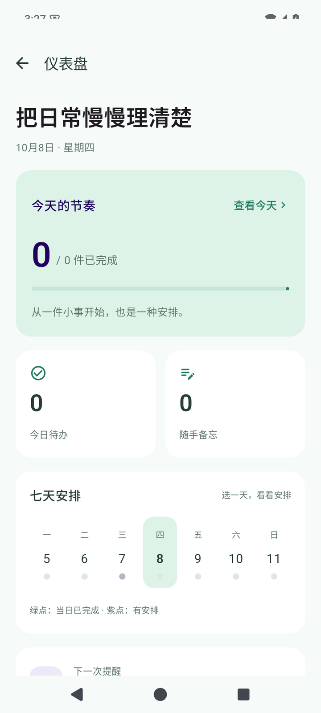
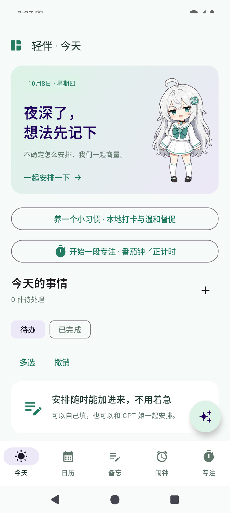
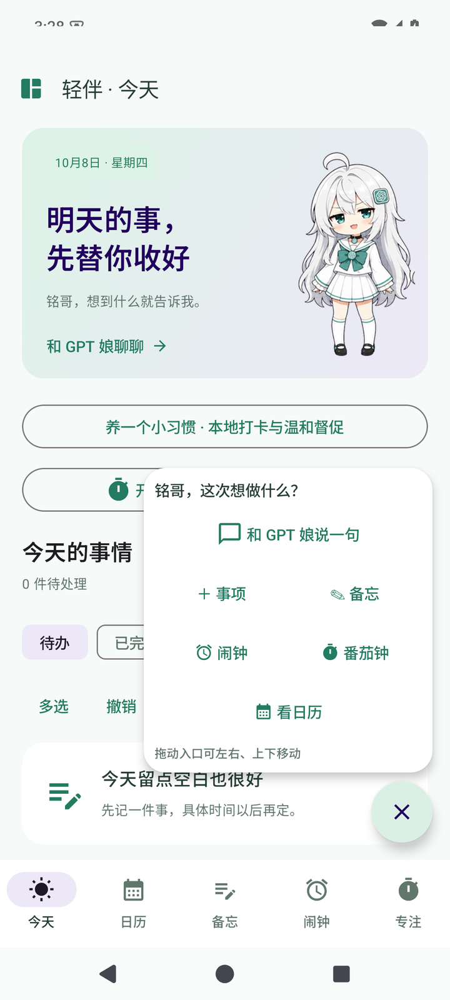
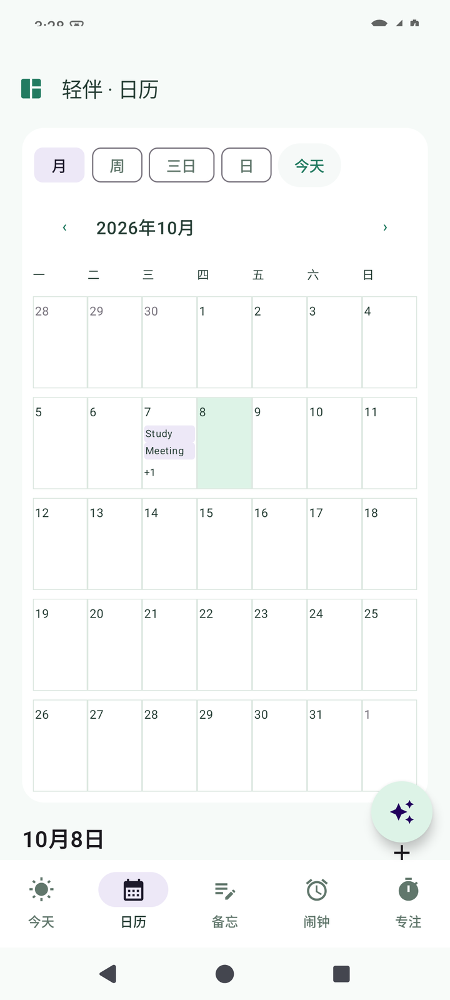
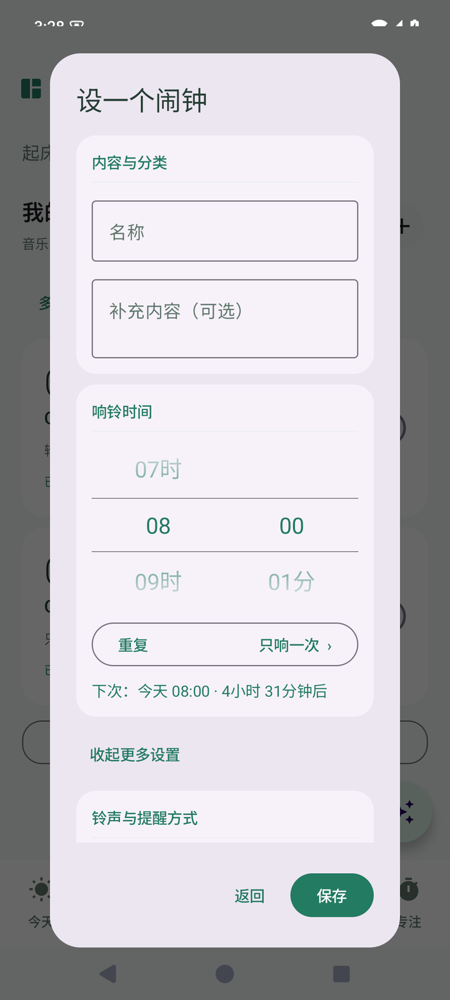
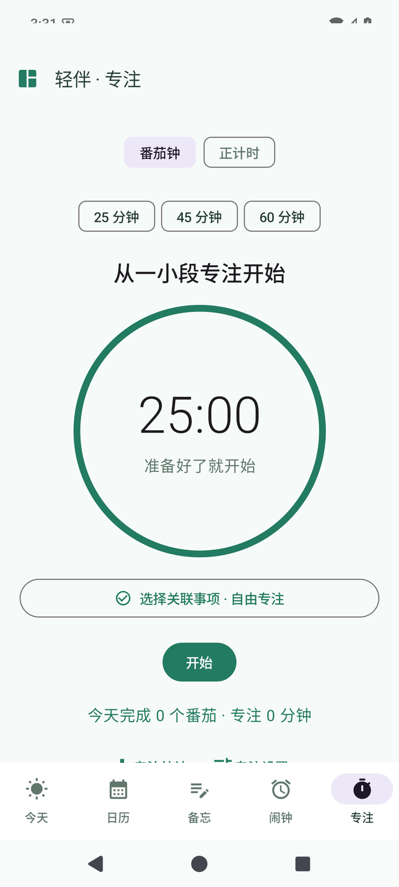

# 轻伴 · Qingban

一句话安排生活的 Android 助手。以单个 GPT 娘为交互入口，将待办、备忘、日历、音乐闹钟、番茄钟、习惯与资料库放在一起，保持薄荷绿与淡紫的二次元风格。

这是以 [FocusPlan](https://github.com/Nichinichisou0706/FocusPlan) 为参考、从零构建的新项目。采用 Kotlin / Jetpack Compose，支持 Android 8.0 及以上，优先适配 Xiaomi HyperOS。

## 下载与安装

[下载最新 Release](https://github.com/Nichinichisou0706/Qingban/releases/latest) · [0.4.5 安装包](https://github.com/Nichinichisou0706/Qingban/releases/download/v0.4.5/Qingban-0.4.5-release.apk)

下载 `Qingban-0.4.5-release.apk`，在手机上允许安装并打开。已有同签名正式版可覆盖升级；升级会保留原有数据。Release 同时提供 `SHA256SUMS.txt`，用于核对下载文件。

通知、精确闹钟、锁屏响铃和悬浮窗权限在“仪表盘 → 权限与桌面”中设置。HyperOS 的自启动和省电限制需要在系统设置中调整。

## 界面预览

| 生活仪表盘 | 今日待办 | 助手快捷展开 |
| :---: | :---: | :---: |
|  |  |  |

| 月历视图 | 音乐闹钟 | 番茄钟 |
| :---: | :---: | :---: |
|  |  |  |

## 能做什么

- **一句话安排**：识别任务、备忘、闹钟和长期重复习惯；信息不足时追问，多项安排先展示方案再确认。复杂操作可连接兼容 OpenAI 接口的模型，离线仍支持手动操作与简单表达。
- **待办与备忘**：按时段分块，区分事项与长期习惯；支持清单、先后依赖、完成、置顶、搜索、多选、全选、批量删除和撤销。重复事项可以操作仅本次、本次及以后或整个系列。
- **日历与仪表盘**：月、周、三日、日视图可切换；七天窗口以今天或选中日居中，展示时间先后与当天完成情况。
- **闹钟**：滚轮选时间，一次性、每日、每周和工作日等重复规则；系统铃声、本地音乐、音乐链接缓存、耳机模式、振动与稍后提醒。可跳转网易云选歌，实际响铃使用本地可用音频。
- **专注与习惯**：番茄钟、正计时、关联事项、专注统计；本地打卡与温和督促。逾期事项提供调整建议，经同意后再更改安排。
- **资料与长期参考**：导入文本、Markdown、PDF、DOCX、图片 OCR、网页和 ICS；先检查内容再保存。资料可设置有效期和是否允许模型参考，习惯与偏好经确认后采用。
- **角色互动**：单角色状态切换、触摸反馈与轻量动画；手机悬浮桌宠常态为 46 × 76 dp，小轮盘展开后为 188 dp，支持动态切换、拖动贴边、五秒闲置淡化。App 前台隐藏悬浮角色。
- **模型配置列表**：管理多套供应商配置、切换启用项、搜索名称、自动发现模型；不支持模型列表的接口可手动填写。
- **数据备份**：JSON 备份与包含原文件、缓存音乐、对话的完整 ZIP 备份；合并时保留本机已有内容，模型密钥不进入备份。

## 0.4.5 更新

- 全部事项、待办和备忘支持多选、全选、删除及整批撤销；待办多选操作栏固定显示。
- 仪表盘、习惯与专注统计的七天窗口改为前三天、今天、后三天；日历周／三日窗口围绕选中日。
- 桌宠常态缩至轮盘中心角色大小，保留淡化、动作、拖动与快捷入口。
- 日常生活待办改为长期重复习惯，与闹钟共用重复规则；完成和清单勾选只影响当天这次。
- 同步智能体的习惯创建、追问、查询、当天完成和删除确认逻辑，补充弱模型使用的详细预设及本地回归。

完整版本说明见 [0.4.5 Release](docs/releases/0.4.5.md)。

## 数据与模型

事项、资料和习惯默认保存在本机。模型密钥通过 Android Keystore 加密保存；资料需按份允许模型参考后，相关片段才会进入请求。导入资料不会自动覆盖偏好或批量建立闹钟。

当前版本已完成 286 项本地测试、架构检查、debug / release Lint、签名与资源校验。Android 15 手机上已验证本轮多选、删除／撤销、重复习惯、日期居中及桌宠尺寸、淡化和拖动。真实模型验收入口保留，本轮未调用真实模型；这些检查不代表所有模型或厂商后台行为均已验收。

## 开发与构建

需要 JDK 17、Android SDK Platform 35、Build Tools 35.0.0。Gradle Wrapper 已包含，设置 `JAVA_HOME` 和 `ANDROID_HOME` 后执行：

```powershell
# 架构、测试、Lint 与 debug 安装包
.\build-debug.ps1

# 同时构建并验证 debug / release，首次生成本地专用 release 签名
.\build-release.ps1

# 依赖已缓存时
.\build-release.ps1 -Offline
```

安装包、校验和与验证元数据输出到 `dist/`。`.signing/` 为本机私有目录，不进入仓库；正式版后续覆盖升级必须复用原签名。详细说明见 [构建准备](docs/release-preparation.md)。

也可直接执行核心验证：

```text
gradlew verifyArchitecture :core:domain:test :core:agent:test :integration:model:test :data:local:testDebugUnitTest :feature:ui:testDebugUnitTest :app:testDebugUnitTest lintDebug lintRelease :app:assembleDebug :app:assembleRelease
```

Python UI 辅助脚本位于 `scripts/`，共享 `device_driver.py`。安装 Python 与 Pillow 后，通过 `ADB`、`ANDROID_HOME` 或 PATH 定位 ADB；默认目标为 `emulator-5554`，实机脚本可显式传入设备序列号。脚本会操作目标设备，请先阅读各脚本的测试范围。截图和诊断只写入本地 `dist/`。

## 模块边界

| 模块 | 职责 |
| --- | --- |
| `app` | 依赖组装、Activity、跨模块备份 |
| `core:domain` | 事项、日期与重复规则、批量操作、资料、记忆、专注和习惯业务 |
| `core:agent` | 对话状态、离线理解、详细预设、工具执行与确认预览 |
| `data:local` | Room 存储、版本校验、事务与备份 |
| `integration:model` | 兼容模型接口、发现与验收入口 |
| `platform:android` | 闹钟、音频、资料解析、通知、悬浮窗、小组件和密钥 |
| `feature:ui` | Compose 页面、ViewModel、角色与交互 |

手动操作与智能体共用业务用例。核心模块不依赖 Android、Room、Compose 或 HTTP 客户端；`verifyArchitecture` 检查依赖方向。

## 能力边界与素材

角色采用现有素材与轻量动画，尚未接入 Live2D。静态网页读取、OCR、日历导入和音乐缓存各有格式与大小限制；音乐平台登录、受保护音频下载和 M3U8 分段直播不在当前范围。手机关机、强行停止应用或系统阻止后台运行时，无法保证响铃。

GPT 娘图片沿用 [青铃](https://github.com/Nichinichisou0706/qingling-alarm) 的处理素材，原始来源和处理方式见 [素材来源](docs/ARTWORK.md)。第三方代码和素材保留各自的许可或使用条款，本仓库不重新授予其使用权，详见 [第三方说明](docs/third-party-notices.md)。

## 项目文档

- [产品大纲](docs/product-outline.md)
- [解耦架构](docs/architecture.md)
- [智能体预设](docs/agent-system-prompt.md)
- [运行协议](docs/runtime-contract.md)
- [手机验收清单](docs/device-acceptance.md)
- [构建、签名与模型验收](docs/release-preparation.md)

设计文档中的扩展方向与历史记录不等同于当前实现，当前能力以本 README 和最新 Release 为准。
