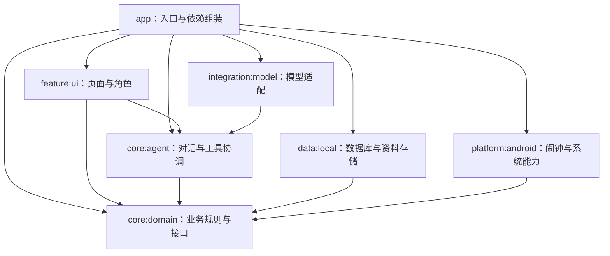

# 手机端从零构建：解耦架构大纲

范围：新的 Android 手机应用，优先适配 HyperOS。本文是设计基线；0.3.0 保持七模块依赖方向，当前实现与限制见项目 README 和 implementation-status.md。

0.3.1 的 DashboardScreen／DashboardViewModel 只读取领域存储摘要，不增加业务写入通道。应用入口发布自身 Activity 是否可见的状态，平台悬浮服务读取该状态隐藏／恢复窗口；平台层仍不依赖 Compose 或 UI 模块。

## 1. 架构目标

更换模型、调整角色美术、修改日历布局、增强资料检索和更换铃声播放器，均不应要求重写事项业务。

智能体与手动界面使用同一套新增、查询、改期、完成、取消和提醒规则。GPT 娘与桌宠作为操作入口，不承担数据和调度责任。

初期采用清晰的模块边界与构造函数注入，不为了“解耦”增加不必要的服务端、消息中间件或大量空接口。

## 2. 首版模块

| 模块 | 职责 | 可直接依赖 |
| --- | --- | --- |
| `:app` | 应用启动、导航装配、依赖组装、Android 组件入口 | 其余六个模块 |
| `:core:domain` | 领域模型、业务策略、用例、存储与调度接口 | Kotlin／必要的 JVM 基础库 |
| `:core:agent` | 对话状态机、提示词组装、结构化决策、工具桥接 | core:domain |
| `:data:local` | Room、资料与偏好存储、导入持久化、备份、迁移 | core:domain |
| `:integration:model` | 不同模型供应商、HTTP、格式适配、凭证读取接口 | core:agent |
| `:platform:android` | 系统闹钟、音频、振动、通知、窗口宿主、权限、系统文件入口 | core:domain、Android SDK |
| `:feature:ui` | Compose 页面、ViewModel、角色组件、用户交互状态 | core:domain、core:agent、Compose／Android UI 库 |

`:core:domain` 和 `:core:agent` 不依赖 Android、Compose、Room 或某个模型厂商 SDK。轻量协程等基础库可以使用，不将纯 Kotlin 等同于“零依赖”。

`:feature:ui` 初期按功能包拆分：today、calendar、memo、alarm、assistant、library、memory、mascot、designsystem。功能变大时再拆 Gradle 模块，不一开始创建大量壳工程。

## 3. 依赖方向

箭头表示“依赖”，只朝向更稳定的边界：



业务层定义需要的接口，外层实现接口。运行时通过 app 组装实际对象；“接口调用进入 Android 适配器”不代表核心层产生 Android 编译依赖。

禁止 data 与 UI、agent 与具体模型适配器、domain 与 Android 平台形成反向依赖或循环依赖。

## 4. 领域边界

### 事项

管理备忘、待办、一次性闹钟记录与重复系列的业务状态。安排时间、截止要求、提醒分别建模。对日期、先后关系、重复范围、版本和撤销做统一校验。

### 提醒与闹钟

业务层定义“何时、以什么方式提醒”，平台层执行。系统调度状态与事项完成状态独立。音乐播放、音频路由和振动属于平台实现。

### 资料库

负责来源、版本、适用期、使用权限、解析内容和检索。原文与索引分开，索引可重建；不把向量库当成唯一事实存储。

### 偏好与习惯

明确偏好、资料事实、行为观察和候选分别建模。习惯统计无需模型；模型只解释候选并提出问题。候选确认后才影响默认安排。

### 智能体

负责对话承接、选择检索、必要追问、决策校验及调用业务用例。它没有数据库连接，也没有直接操控 AlarmManager 的权限。

### 角色与桌宠

负责展示状态、动画与输入入口。它可以观察简化的事项摘要和助手状态，但不拥有任务列表、资料索引或闹钟调度。

这些边界初期是模块内包与接口，不要求每个边界都独立成 Gradle 工程。

## 5. 关键接口示意

以下是说明边界的 Kotlin 伪代码；实际类型在实现时补全，避免把文档直接当作可编译源码。

```kotlin
// 定义在 core:domain；外层负责数据库与版本校验。
interface ItemStore {
    suspend fun get(id: ItemId): ItemSnapshot?
    suspend fun commit(command: ItemCommand, requestKey: RequestKey): CommitResult
}

// 定义在 core:domain；检索受资料使用权限与有效期约束。
interface KnowledgeRetriever {
    suspend fun retrieve(request: KnowledgeRequest): KnowledgeResult
}

// 定义在 core:domain；平台负责准确时间、重复与取消的系统实现。
interface ReminderScheduler {
    suspend fun reconcile(request: ScheduleRequest): ScheduleResult
}

// 定义在 core:agent；具体供应商实现位于 integration:model。
interface ModelClient {
    suspend fun decide(input: AgentInput): ModelDecision
}
```

资料 parser 使用独立 `DocumentParser` 接口。文本／Markdown 首版实现，PDF／图片等后续实现不能反过来侵入事项用例。

铃声播放器通过平台内部 `AudioPlayer` 接口隔离。耳机路由通过 `AudioRouteMonitor` 提供状态，播放器不读取事项数据库。

当前时间通过 `ClockProvider` 与 `ZoneProvider` 注入。测试替换时钟；业务代码不能各自调用系统时钟而对“明天”得出不同结论。

模型凭证通过 app 注入的 `CredentialProvider` 读取，Android Keystore 的具体实现留在平台层。设置 UI 接收用户新输入的密钥，不读取已有明文；密钥不进入资料库或提示词上下文。

## 6. 两个入口，一套业务

### 手动新增

表单 → ViewModel → CreateItemUseCase → 业务校验 → ItemStore → 提醒调度 → 结果状态。

### 智能体新增

用户输入 → AgentCoordinator → ModelClient → 决策 Schema 校验 → 工具桥接 → CreateItemUseCase → 相同业务校验与执行。

核心用例至少包括 CreateItem、UpdateItem、CompleteItem、CancelItem、QueryItems、ProposeChanges、ApplyProposal、UndoChange、SearchKnowledge、UpdatePreference。

接口不允许通过新增第二条“AI 专用写入通道”绕过版本、授权或重复规则。

## 7. 对话与工具协议的隔离

模型输出的 JSON 只属于 agent 的传输协议。AgentCoordinator 将已验证 JSON 转换为类型明确的领域命令。

业务用例接收 ItemCommand、ScheduleSpec 等领域类型，不接收任意 JSON、提示词、聊天正文或供应商返回对象。

工具桥接维护一个集中注册表，把工具名映射到用例与参数 Schema。业务规则在 domain 中实现，工具桥接不复制同一套规则。

用户授权状态与待答草稿由程序保存，模型生成“已经同意”文字不能更改授权。供应商更换后，现有待答问题、方案和事项仍然有效。

提示词单独版本化，记录 prompt_version、模型配置与工具协议版本。提示词变更不能悄悄改变数据库字段或提醒策略。

## 8. UI 状态与角色状态

每个页面有自己的 ViewModel 与 UiState，不设置一个同时负责全应用数据库、聊天、播放器和排程的 MainViewModel。

全局只保留必要的共享状态：当前会话、应用导航、正在响铃的提示等，通过明确接口访问。

角色可用状态：Idle、Thinking、Asking、WaitingForAnswer、Success、Reminder、Error。由程序事件映射，不依赖模型输出表情名字。

角色组件接收 `PetViewState` 和 `onAction` 回调：

```kotlin
// 位于 feature:ui，仅负责绘制和用户动作。
@Composable
fun GptPet(
    state: PetViewState,
    onAction: (PetAction) -> Unit
)
```

Android 窗口宿主只负责添加、移动与移除窗口。app 中的服务入口把 UI 创建的 View 交给平台宿主，不让 platform:android 依赖整个 feature:ui。

角色透明素材、主题、表情映射与提示词分别维护；换立绘不改工具定义，换模型不改动画代码。

## 9. 资料库和习惯的隔离

资料导入：系统文件选择 → parser → 原文与解析文本保存 → 索引更新 → 可选候选提取。

0.3.0 的原文件由 platform:android 的 OriginalDocumentVault 保管，领域层只保存附件元数据；app 协调文件打开与 ZIP 编排。备份格式校验位于纯 JVM 的 BackupCodec，data:local 执行 Room 恢复。偏好与操作回执通过 SessionStore.transaction 共享同一数据库事务，核心层不引入 Room。

资料问答：检索用例 → 适用期与权限过滤 → 带来源片段 → agent → 回答及引用卡片。

习惯学习：已发生的用户操作 → 最小观察事件 → 学习开关检查 → 统计 → 候选 → 用户确认 → 偏好用例。

模型不负责判断计数是否达到门槛；资料导入不自动写成已确认偏好。用户界面和智能体都通过同一个偏好用例修改。

观察记录要标明来源为用户、程序或模型建议。不能把程序自己安排的时间当作用户反复选择的证据。

首版用明确的事件类型和小型本地观察表即可，不把整个应用设计成复杂事件溯源系统。

## 10. 调度与持久化可靠性

数据库成功不代表系统闹钟已启用。保存事项时，同时持久化必要的待调度记录；提交后执行调度，并保存确认状态。

- 调度适配器按事项／发生次 ID 和版本幂等处理。
- 旧版本调度结果不能覆盖新版本。
- 网络重试或模型重试不创建重复事项。
- 停止／断网时保留请求身份、工具进度及正在执行的工具，继续请求沿用身份。事项与撤销记录随数据库事务保存，偏好和去重回执同样原子保存。
- 系统调度失败返回 partial，保留待处理状态和修复入口。
- 重启／时区变化后由平台调度恢复服务读取待调度记录并重新协调。
- 补偿操作与重试有界，避免无限重试影响电量。

不要把 Android 系统调用放在长数据库事务里。系统服务的副作用无法获得数据库事务式原子性，因此用可追踪的待调度状态恢复。

桌宠服务与响铃服务独立：关闭桌宠不调用闹钟取消逻辑；角色动画停止不停止正在运行的音乐闹钟。进程回收或强行停止的系统边界仍要按 Android 实际行为处理。

## 11. 数据模型与迁移

Room Entity 仅出现在 data:local，转换为领域模型后再输出。Compose 不接收 Entity；模型上下文只得到必要的读取摘要。

核心对象可包括 Item、ScheduleSpec、DeadlineSpec、ReminderSpec、RecurrenceSpec、KnowledgeSource、ConfirmedPreference、HabitCandidate、PendingQuestion、Proposal、ChangeRecord。

不创建一个塞满所有字段的万能 Task。ScheduleSpec 与 ReminderSpec 可复用，但知识资料、用户偏好和事项记录保留独立语义。

备份包带版本，恢复走 data:local 的迁移和校验。模型输出格式不作为长期备份格式。

## 12. 从零构建顺序

1. 建立七个模块与依赖约束，确保纯核心模块能独立编译。
2. 实现领域类型、核心用例和内存适配器，先验证手动新增／改期／完成。
3. 接入本地数据库与迁移，保留同一套用例接口。
4. 接入系统提醒和音乐闹钟，验证保存、调度、停止与稍后提醒。
5. 接入最小资料库、明确偏好与管理界面。
6. 实现 agent 状态机和工具协议，先用假模型适配器验证流程，再接真实模型。
7. 接入 GPT 娘组件与可选手机悬浮宠物。
8. 加入习惯候选、弱模型评估与真机长期待机验收。

每一步都有可运行闭环，不先堆满全部页面再把业务补进 UI。

## 13. 评审与验证约束

- 核心模块中不出现 Android、Room、Compose、HTTP 供应商 SDK 的导入。
- UI 与模型适配器不能直接写数据库或调用系统调度。
- 手动输入与智能体输入同样经过业务用例。
- 事项改期、重复范围、日期解析、去重和偏好确认有针对性的核心测试。
- 调度适配器单独验证权限、重启恢复、失效版本和音频路线。
- 模型协议与必要追问使用固定场景评估，不用界面动画测试代替业务验证。
- 手机桌宠验证触摸范围、隐藏与恢复、权限缺失和耗电；不为简单视觉修改编写镜像式测试。
- 构建脚本维护模块依赖白名单；架构变更需同步修改本文件，防止边界逐渐失效。

这些要求用于持续评审。当前已建立工程并加入核心单元测试、模块依赖检查与 Android Lint；按用户要求暂不执行实机测试。
